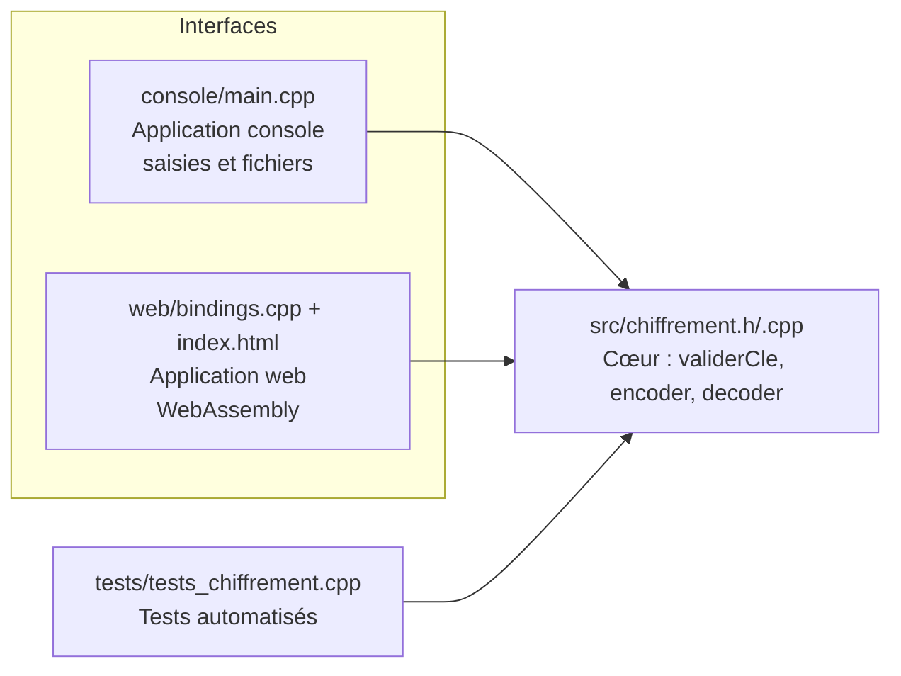

# Encodeur / Décodeur de fichiers

[](https://github.com/Nick-Suebang/encodeur-et-decodeur-de-fichier/actions/workflows/ci.yml)
[](https://github.com/Nick-Suebang/encodeur-et-decodeur-de-fichier/actions/workflows/pages.yml)


Un programme en C++ qui chiffre et déchiffre des fichiers texte à l'aide d'une clé. Il est disponible en **application console** et en **application web** : le même code C++, compilé en WebAssembly, s'exécute directement dans le navigateur.

### [▶ Essayer en ligne](https://nick-suebang.github.io/encodeur-et-decodeur-de-fichier/)

Aucune installation : le texte et la clé restent dans le navigateur, rien n'est envoyé à un serveur.

---

## Sommaire

- [Fonctionnalités](#fonctionnalités)
- [Fonctionnement de l'algorithme](#fonctionnement-de-lalgorithme)
- [Architecture](#architecture)
- [Démarrage rapide](#démarrage-rapide)
- [Utilisation de la console](#utilisation-de-la-console)
- [Version web](#version-web)
- [Tests et intégration continue](#tests-et-intégration-continue)
- [Spécifications et limites](#spécifications-et-limites)
- [Choix techniques](#choix-techniques)

---

## Fonctionnalités

- **Encodage et décodage** de textes et de fichiers avec une clé de 5 à 20 caractères.
- **Deux interfaces sur un seul cœur** : une console en C++17 standard (compilée en CI sous Windows et Linux) et une page web.
- **Saisies robustes** : choix du menu, fichiers et clé sont redemandés tant qu'ils sont invalides.
- **Aucune perte de données** : le fichier produit doit être différent du fichier traité, et il n'est écrit que si tout le traitement a réussi.
- **Fins de ligne préservées** : `\n` et `\r\n` sont conservés à l'identique.
- **Tests automatisés** : plus de 6 000 vérifications, exécutées à chaque modification.
- **Déploiement continu** : la version web est recompilée et republiée automatiquement, seulement si les tests passent.

## Fonctionnement de l'algorithme

Il s'agit d'un **chiffrement par décalage à clé répétée**, de la même famille que le chiffre de Vigenère, appliqué aux 95 caractères ASCII imprimables (codes 32 à 126).

1. Chaque caractère de la clé donne un décalage, mesuré par rapport à la lettre `a` : `a` → 0, `b` → 1, `z` → 25, `A` → -32, `!` → -64.
2. Chaque caractère imprimable du texte est décalé selon le caractère courant de la clé. La clé est réutilisée en boucle.
3. Le résultat est ramené dans la plage 32-126 (arithmétique modulo 95). Un texte encodé ne contient donc que des caractères imprimables.
4. Les retours à la ligne sont recopiés tels quels et ne font pas avancer la clé.
5. Le décodage applique le décalage inverse.

**Exemple** : `Bonjour` encodé avec la clé `abcde`

| Texte | `B` | `o` | `n` | `j` | `o` | `u` | `r` |
|---|---|---|---|---|---|---|---|
| Clé | `a` | `b` | `c` | `d` | `e` | `a` | `b` |
| Décalage | +0 | +1 | +2 | +3 | +4 | +0 | +1 |
| **Résultat** | `B` | `p` | `p` | `m` | `s` | `u` | `s` |

`Bonjour` → `Bppmsus`

> [!WARNING]
> Ce chiffrement est un projet pédagogique : il se casse facilement par analyse de fréquences. Ne l'utilisez pas pour protéger des données sensibles ; préférez un algorithme reconnu comme AES-GCM.

## Architecture

L'algorithme est isolé dans un **cœur sans aucune dépendance** aux fichiers ni à la console. Chaque interface s'occupe uniquement de ses entrées et sorties, et appelle le même code.



```
.
├── src/
│   ├── chiffrement.h          API du cœur : constantes, erreurs, encoder / decoder
│   └── chiffrement.cpp        Implémentation (fonctions pures)
├── console/
│   └── main.cpp               Application console
├── web/
│   ├── bindings.cpp           Expose le cœur à JavaScript (Emscripten / embind)
│   ├── index.html             Interface web
│   └── build.sh               Compilation en WebAssembly
├── tests/
│   ├── tests_chiffrement.cpp  Tests du cœur
│   └── run.sh                 Compile et lance les tests
├── .github/workflows/
│   ├── ci.yml                 Intégration continue
│   └── pages.yml              Tests, compilation et publication sur GitHub Pages
├── Encodeur-Decodeur.sln      Solution Visual Studio
└── Encodeur-Decodeur.vcxproj  Projet Visual Studio (console)
```

Le cœur expose une API minimale :

```cpp
namespace chiffrement
{
    Erreur      validerCle(const std::string& cle);
    Resultat    encoder(const std::string& texte, const std::string& cle);
    Resultat    decoder(const std::string& texte, const std::string& cle);
    std::string messageErreur(Erreur erreur);
}
```

Les erreurs sont renvoyées sous forme de valeurs (`Erreur`, `Resultat`) plutôt que d'exceptions ou de messages affichés. Chaque interface décide ainsi elle-même comment les présenter.

## Démarrage rapide

### Prérequis

| Pour… | Il faut |
|---|---|
| la console | un compilateur C++17 : Visual Studio 2022, g++ 9+ ou clang 10+ |
| la version web | [Emscripten](https://emscripten.org/docs/getting_started/downloads.html) |
| les tests | g++ ou clang++ et un shell POSIX (Linux, macOS, WSL ou Git Bash) |

### Récupérer le projet

```bash
git clone https://github.com/Nick-Suebang/encodeur-et-decodeur-de-fichier.git
```

```bash
cd encodeur-et-decodeur-de-fichier
```

### Compiler la console

**Avec Visual Studio** : ouvrir `Encodeur-Decodeur.sln`, puis **Générer → Générer la solution**. Lancer avec **Ctrl+F5** pour que la fenêtre reste ouverte à la fin.

**Avec g++ ou clang++** :

```bash
g++ -std=c++17 -O2 -I src console/main.cpp src/chiffrement.cpp -o encodeur-decodeur
```

## Utilisation de la console

```text
---------- M_E_N_U ----------
Que voulez-vous faire ?
1) Encoder un fichier.
2) Décoder un fichier.
Votre choix : 1
Entrer le nom du fichier à traiter : message.txt
Entrer le nom du fichier à produire : message_encode.txt
Entrer la clé de traitement : abc
Erreur : La clé doit contenir entre 5 et 20 caractères.
Entrer la clé de traitement : Secret!42
Encodage terminé.
```

Pour retrouver le texte d'origine, relancer le programme, choisir `2` et utiliser la même clé.

| Situation | Comportement |
|---|---|
| Choix de menu autre que `1` ou `2` | Message d'erreur, le choix est redemandé |
| Fichier à traiter introuvable | Le nom est redemandé |
| Fichier à produire identique au fichier à traiter | Refusé, pour ne pas écraser l'original |
| Clé invalide | Le motif est affiché, la clé est redemandée |
| Caractère non supporté dans le texte | Erreur, aucun fichier produit |
| Fin de saisie (Ctrl+Z / Ctrl+D) | Arrêt propre |

**Codes de retour** : `0` en cas de succès, `1` en cas d'erreur. Le programme peut donc être utilisé dans un script, avec une entrée redirigée :

```bash
printf '1\nmessage.txt\nmessage_encode.txt\nSecret!42\n' | ./encodeur-decodeur
```

## Version web

L'application web est en ligne sur **https://nick-suebang.github.io/encodeur-et-decodeur-de-fichier/**.

Elle permet de saisir un texte ou d'ouvrir un fichier `.txt` (y compris par glisser-déposer), de vérifier la clé pendant la saisie, de copier ou télécharger le résultat, et de décoder immédiatement un texte qu'on vient d'encoder.

`web/bindings.cpp` expose les fonctions du cœur à JavaScript avec embind ; Emscripten compile le tout en un module WebAssembly chargé par `index.html`.

Pour la compiler et la tester en local :

```bash
sh web/build.sh
```

```bash
cd web/dist && python3 -m http.server 8000
```

Puis ouvrir http://localhost:8000.

## Tests et intégration continue

```bash
sh tests/run.sh
```

Ce script compile les tests et la console avec `-Wall -Wextra -Wpedantic -Werror`, puis lance les tests. Ceux-ci couvrent :

- la validation de la clé (longueurs limites, espaces, accents, tabulations) ;
- des valeurs de référence connues ;
- la conservation des fins de ligne `\n` et `\r\n` ;
- les cas d'erreur, sans résultat partiel ;
- **2 000 textes aléatoires** (graine fixe, donc reproductibles) : avec une clé en minuscules, résultat identique à l'algorithme d'origine ; avec n'importe quelle clé, aller-retour exact et sortie toujours imprimable.

| Workflow | Déclenchement | Étapes |
|---|---|---|
| [`ci.yml`](.github/workflows/ci.yml) | chaque push et chaque pull request | tests avec g++ · compilation de la solution Visual Studio avec MSVC (x64 et x86, avertissements traités comme des erreurs) · compilation de la version web |
| [`pages.yml`](.github/workflows/pages.yml) | chaque push sur `main` | tests · compilation WebAssembly · publication sur GitHub Pages |

## Spécifications et limites

| | Règle |
|---|---|
| **Clé** | 5 à 20 caractères ASCII imprimables (codes 33 à 126), sans espace ni accent |
| **Texte accepté** | caractères ASCII imprimables (codes 32 à 126) et retours à la ligne |
| **Texte refusé** | accents, émojis, tabulations et autres caractères de contrôle |
| **Taille** | le fichier est chargé entièrement en mémoire ; conçu pour des fichiers texte |
| **Sécurité** | chiffrement pédagogique, non adapté à des données sensibles |

## Choix techniques

- **Séparation du cœur et des interfaces** : l'algorithme n'existe qu'en un seul exemplaire, testable sans fichiers ni console, et réutilisé tel quel par la console et par le web.
- **Erreurs sous forme de valeurs** plutôt que d'affichages ou d'exceptions : le cœur ne présuppose rien de l'interface qui l'utilise.
- **Écriture tout ou rien** : le fichier est lu entièrement, transformé, puis écrit seulement en cas de succès, pour ne jamais laisser de fichier à moitié produit.
- **Lecture et écriture en binaire** : les octets sont traités tels quels, sans conversion implicite des fins de ligne selon le système.
- **UTF-8 de bout en bout** : sources en UTF-8 (`/utf-8` pour MSVC), console Windows passée en UTF-8, noms de fichiers accentués pris en charge.
- **WebAssembly plutôt qu'un serveur** : la version web n'a besoin d'aucun backend, ne coûte rien à héberger et ne transmet aucune donnée.
- **Compatibilité** : avec une clé en minuscules, les résultats sont identiques à ceux de la première version du programme ; c'est vérifié par les tests.

---

Réalisé par [Nick Suebang](https://github.com/Nick-Suebang).
